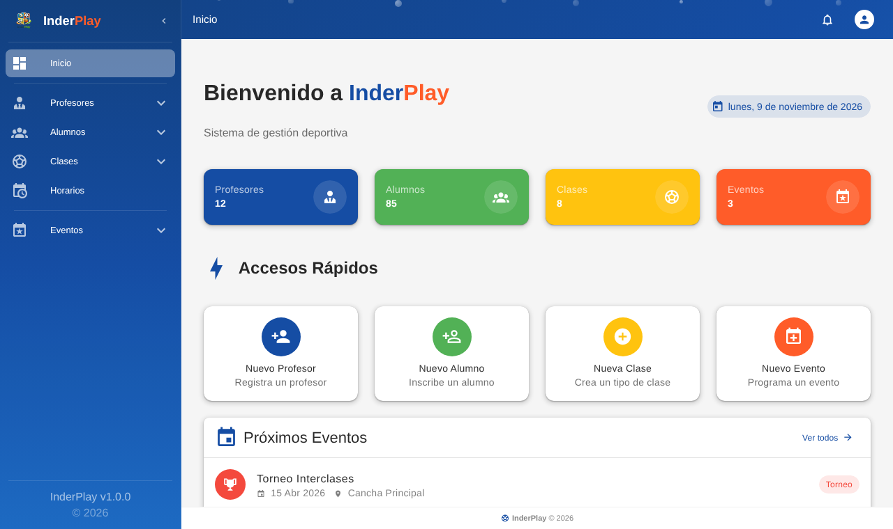
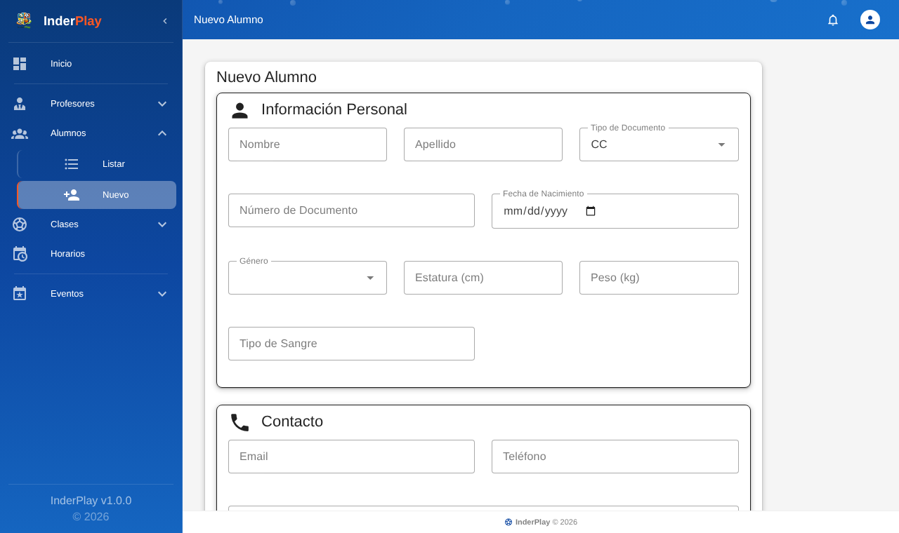

# InderPlay: sports management frontend

Web app to manage a sports school: coaches, students, classes, schedules and events. Built with **Vue 3, Vite, Vuetify and Vue Router**, talking to a REST API through Axios.

Team project. This fork contains my part: the UI redesign with Vuetify, the navigation layout and the complete forms for every module. The original repository is [juanldslv/front-gestion-deportiva](https://github.com/juanldslv/front-gestion-deportiva). The UI is in Spanish.





## Modules

| Module | What it does |
| --- | --- |
| Profesores | List, create and edit coaches, assign classes and schedules |
| Alumnos | Student registry with personal, contact and health data |
| Clases | Class types offered by the school |
| Horarios | Weekly schedule configuration |
| Eventos | Tournaments and events, with student enrollment |

## Structure

```
src
├── components/layout   AppHeader and AppNavigation (collapsible side menu)
├── views               one folder per module (list and form views)
├── services            Axios clients per resource (alumno, profesor, clase, horario, evento)
├── router              routes for every view
└── plugins/vuetify.js  theme and components
```

## Running it

```bash
npm install
npm run dev
```

The API URL defaults to `http://localhost:8080/api`. To change it, copy `.env.example` to `.env.local` and set `VITE_API_URL`.

## Tech

Vue 3, Vite, Vuetify, Vue Router, Axios, Material Design Icons.
